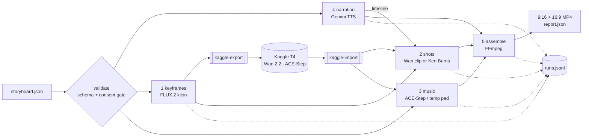

# Architecture

One file, `storyboard.json`, is the contract. Five stage scripts read it, write into `outputs/`, and log every model call to `runs.jsonl`. No stage talks to another stage directly: they meet only through the storyboard and files on disk.



## Stages and contracts

| # | Stage (`make …`) | Reads from the storyboard | Writes | Model / tool |
|---|---|---|---|---|
| – | `validate` | everything | nothing (stops the run on error) | jsonschema |
| 4 | `narration` | `shots[].narration.am`, `voice` | `outputs/narration/raw/<id>_<key>.wav` (model), `outputs/narration/<id>_<key>_p450.wav` (pauses capped) | Gemini 3.8 Flash TTS, stock voice *Charon* |
| 1 | `refs`, `keyframes` | `image_prompt` / `no_face_prompt`, `seed`, `style`, `references`, `consent` | `outputs/references/*.png`, `outputs/keyframes/<id>_<key>.png`, `contact_sheet.jpg` | FLUX.2 klein 4B on Cloudflare Workers AI |
| 2 | `shots` | `kenburns`, `video`, timeline | `outputs/shots/{vertical,horizontal}/<id>_<key>.mp4` | FFmpeg; Wan 2.2 TI2V-5B clips from Kaggle when present |
| 3 | `music` | `music` | `outputs/music/score_seed<n>_<key>.wav` or `placeholder_<key>.wav` | ACE-Step 1.5 on Kaggle; FFmpeg temp pad until then |
| 5 | `assemble` | `render`, `mix`, `consent`, narration English text | `outputs/final/*_vertical.mp4`, `*_horizontal.mp4`, `subtitles_en.srt`, `report.json` | FFmpeg |

Narration runs before pictures on purpose: the voice sets the pace. `narration.timeline()` makes each shot `max(planned duration, lead-in + spoken line + 0.6 s)`, so a long line is never cut off, and `make timing` shows the result before anything is rendered.

The GPU stages cannot run on the author's laptop. `make kaggle-export` packs the current keyframes and a `jobs.json` (motion prompts, seeds, music caption/bpm/key/seeds) into one zip. The notebooks in `notebooks/` run on Kaggle and write their own log lines in the same format. `make import ZIP=…` puts clips and music where the stages look for them and merges those log lines into `runs.jsonl`.

## Caching: only what changed is regenerated

Every output file name contains the first 12 characters of a SHA-256 of **all** the inputs that produce it (`common.canonical_hash`, which sorts JSON keys first). If the file exists, the stage skips the call and logs a `cache_hit` line.

| Output | Key includes |
|---|---|
| narration (model) | Amharic text, voice, style, TTS model |
| narration (processed) | the above + `max_pause_s` (no model call) |
| keyframe | final prompt (shot + character + style blocks), seed, size, model, hash of each reference image |
| Wan clip | the keyframe key (the clip is named after the keyframe it came from) |
| shot segment | source file hash, Ken Burns direction, length, size, fps |
| mix | hashes and start times of every narration file, score hash, mix settings, length |

So editing one `image_prompt` regenerates one keyframe and its two segments; editing one narration line makes one TTS call, and its timeline shift re-renders only the segments whose length changed. Assembly itself is always re-run: it is deterministic FFmpeg and makes no model calls. Writes go to `*.part` and are renamed when complete, so an interrupted call never leaves a half file that looks cached. Model outputs are committed to git, so a clean clone gets cache hits instead of new API calls; derived files (segments, mixes) are git-ignored and rebuilt by FFmpeg.

## Failure handling

- **Validation first.** Every stage calls `load_storyboard()`: JSON Schema (no unknown fields, ranges, enums) plus cross-field checks (unique ids, 60–90 s, chosen seeds exist, a `no_face_prompt` on every character shot, and the consent flag agreeing with ETHICS.md).
- **Retries** (`common.call_with_retries`): up to 4 attempts on 429/5xx, connection errors and timeouts, with exponential backoff. On a 429 the server's own hint ("retry in 39s") is used. If the hint is longer than 2 minutes (a daily quota, e.g. "retry in 17h50m8s"), it fails immediately with a clear message instead of sleeping. 4xx client errors are not retried. Every attempt, failed or not, is one line in `runs.jsonl`.
- **Fallbacks.** Gemini Flash overloaded → Flash-Lite. No Wan clip (no GPU, OOM, clip rejected) → Ken Burns over the keyframe. No ACE-Step score yet → FFmpeg pad. The film can always be finished.
- **Consent gate.** While `consent.likeness_approved` is false, character shots use `no_face_prompt`, the character sheet is not generated, and Wan prompts for those shots ask for the face to stay hidden. While `consent.script_approved` is false, both exports carry a visible DRAFT mark.
- **Verification.** Assembly probes both exports (duration 60–90 s, exact size, H.264 + AAC, loudness within 1 LU of the target, true peak) and writes `outputs/final/report.json`; it exits non-zero if a check fails.

## Logging

`runs.jsonl` gets one JSON line per model call attempt: `ts`, `run_id`, `stage`, `shot`, `provider`, `model`, `params`, `seed`, `cache_key`, `output`, `attempt`, `status`, `http_status`, `latency_s`, `error`, `cost` (tokens/characters for Gemini, estimated neurons and list-price USD for Cloudflare, GPU minutes for Kaggle). Non-model events (`cache_hit`, `consent_gate`, `render`, `mix`, `validation`, `stage_done`) are logged too, so a run can be followed end to end. `make costs` turns the log into the table in COSTS.md.

## Code map

```
run.py               CLI: one command per stage, `film` runs them in order
pipeline/common.py   paths, runs.jsonl logger, hashing, cache helpers, retries, ffprobe
pipeline/providers.py  Gemini text, Gemini TTS, Cloudflare FLUX.2 klein clients
pipeline/validate.py schema + cross-field checks + consent gate
pipeline/narration.py  stage 4 and the timeline
pipeline/audio.py    pause compressor (pure Python, deterministic)
pipeline/keyframes.py  stage 1 and reference sheets
pipeline/shots.py    stage 2 (Wan clip or Ken Burns)
pipeline/music.py    stage 3 (ACE-Step candidate or temp pad), loudness matching
pipeline/assemble.py stage 5: subtitles, end card, mix, render, verify
pipeline/radio.py    radio cut for the first user test
pipeline/kaggle_io.py  export/import for the GPU notebooks
pipeline/costs.py    runs.jsonl -> COSTS.md
notebooks/           wan_video.ipynb, ace_step_music.ipynb (Kaggle)
tests/               offline tests: fake models, real FFmpeg
```
